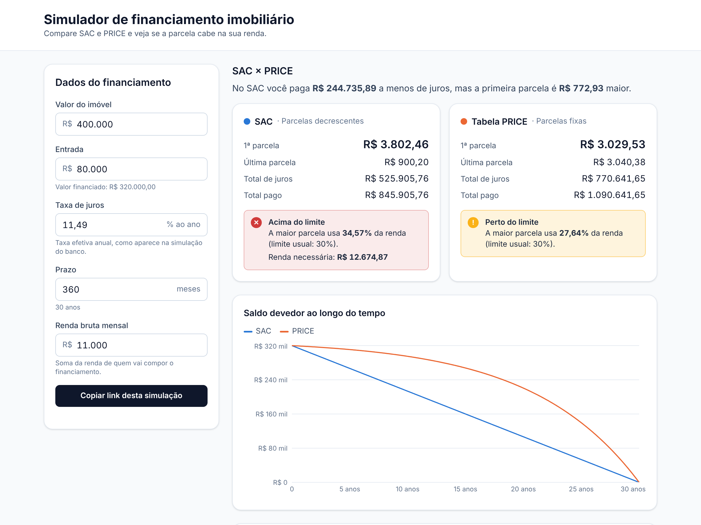

# Simulador de Financiamento Imobiliário

Simulador que compara os sistemas **SAC** e **PRICE** lado a lado, com tabela de
amortização completa, gráficos e alerta de comprometimento de renda.

Projeto de portfólio feito por um corretor de imóveis que estuda Sistemas para
Internet: a ideia é responder com números a pergunta que todo cliente faz —
*"qual sistema vale mais a pena para mim?"*



**[Abrir o simulador](https://simulador-financiamento-blush.vercel.app)**

## Funcionalidades

- [x] Cálculo SAC e PRICE com arredondamento ao centavo
- [x] Conversão de taxa anual efetiva/nominal → mensal
- [x] Comparação de juros totais e diferença da 1ª parcela
- [x] Alerta de comprometimento de renda (padrão: 30%)
- [x] Formulário com validação por campo (aceita "400.000,50" e "11,49")
- [x] Tabela de amortização mês a mês, alternando SAC/PRICE
- [x] Gráficos de saldo devedor e composição da parcela (Recharts)
- [x] Link compartilhável: os valores ficam na URL
- [x] Deploy na Vercel, com prévia do link no WhatsApp/LinkedIn (Open Graph)
- [x] Seguros MIP e DFI, taxa de administração e CET estimado
- [x] Amortização extra (FGTS): reduzir prazo × reduzir parcela, única ou recorrente
- [x] Testes de ponta a ponta com Playwright, no CI e após cada deploy
- [x] Imóvel máximo que o cliente pode comprar (e se quem limita é a renda ou a entrada)
- [x] Taxa de referência pela renda: faixas do Minha Casa, Minha Vida ou taxas de mercado
- [x] Resumo pronto para WhatsApp e glossário dos termos
- [x] Cota de financiamento editável (até 90%) e prazo de até 35 anos

## Stack

React · TypeScript · Vite · Tailwind CSS · Recharts · Vitest · Playwright

## Como rodar

```bash
npm install
npm run dev        # servidor de desenvolvimento
npm test           # testes em modo watch
npm run coverage   # testes + relatório de cobertura (mínimo 100% em src/lib)
npm run build      # typecheck + build de produção
npm run e2e        # testes de ponta a ponta (sobe o build local)
npm run e2e:producao  # os mesmos testes contra o site publicado
```

Na primeira vez, instale o navegador do Playwright: `npx playwright install chromium`.

## Estrutura

```
src/
├── lib/                     # lógica pura, sem React (100% de cobertura)
│   ├── financiamento/       # regras de negócio
│   │   ├── dinheiro.ts      # reais ↔ centavos, formatação BRL
│   │   ├── taxas.ts         # conversão de taxas
│   │   ├── motor.ts         # motor único de amortização (+ pagamentos extras)
│   │   ├── sac.ts, price.ts # os dois sistemas, como casos do motor
│   │   ├── encargos.ts      # seguros MIP/DFI e taxa de administração
│   │   ├── cet.ts           # taxa interna de retorno e CET
│   │   ├── capacidade.ts    # imóvel máximo pela renda e pela entrada
│   │   ├── renda.ts         # comprometimento de renda
│   │   └── simulacao.ts     # simular(): orquestra tudo para a UI
│   ├── formulario/          # texto digitado → números; estado ↔ URL
│   ├── taxasReferencia.ts   # tabela MCMV e taxas de mercado (com fonte e data)
│   ├── resumoCliente.ts     # texto do resumo para WhatsApp
│   └── graficos.ts          # dados prontos para o Recharts
├── hooks/useSimulacao.ts    # estado do formulário sincronizado com a URL
├── components/              # UI (formulário, cartões, tabela, gráficos)
└── App.test.tsx             # testes de integração da interface (jsdom)
e2e/                         # testes de ponta a ponta (Playwright)
```

Os testes ficam ao lado de cada módulo (`*.test.ts`).

## Exemplo de uso do módulo

```ts
import { formatarBRL, simular } from './lib/financiamento'

const r = simular({
  valorImovel: 400_000_00, // centavos
  entrada: 80_000_00,
  taxaAnual: 0.1149, // 11,49% a.a. efetiva
  prazoMeses: 360,
  rendaMensal: 15_000_00,
})

formatarBRL(r.sac.resumo.primeiraPrestacao) // "R$ 3.802,46"
formatarBRL(r.price.resumo.primeiraPrestacao) // "R$ 3.029,53"
r.comparacao.economiaJurosSac // juros a menos no SAC, em centavos
```

## Decisões técnicas

As escolhas de arquitetura, precisão numérica, arredondamento e testes estão
explicadas em [`docs/DECISOES.md`](docs/DECISOES.md).

## Aviso

Simulação educativa. Seguros e taxa usam os valores informados (os padrões são
exemplos); o cálculo não inclui correção pela TR nem custos de contratação. Os
valores reais dependem das condições de cada banco.
